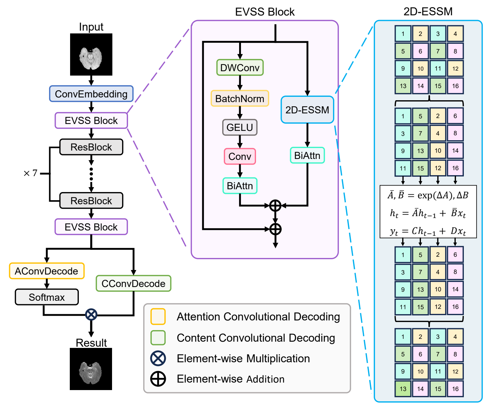
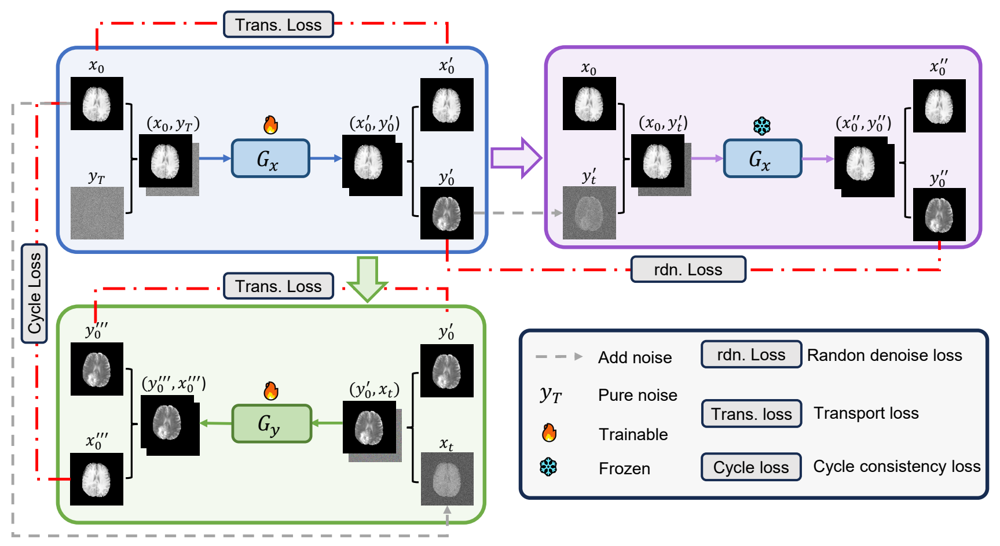
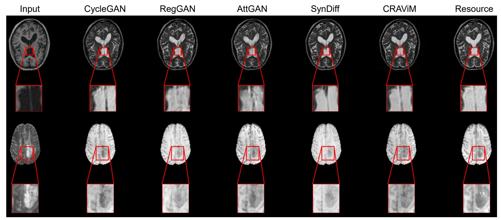

<div align="center">

# CRAViM

### Hybrid State-Space Models and Denoising Training<br>for Unpaired Medical Image Synthesis

**MICCAI 2025**

Junming Zhang · Shancheng Jiang  
Sun Yat-sen University

[](https://papers.miccai.org/miccai-2025/paper/1652_paper.pdf) [](https://doi.org/10.1007/978-3-032-04937-7_23) [](https://pytorch.org/get-started/previous-versions/)

**[Overview](#overview) · [Method](#method) · [Results](#results) · [Installation](#installation) · [Data](#data-preparation) · [Training](#training) · [Testing](#testing) · [Citation](#citation)**

</div>

Official PyTorch implementation of **CRAViM (Convolutional Residual Attention Vision Mamba)** for unpaired medical image synthesis. This repository provides the model, training code, and bidirectional inference and evaluation scripts.

## Overview

CRAViM combines convolutional feature extraction with Vision Mamba to capture local anatomical details and long-range spatial dependencies. A cycle denoise consistency framework, with transport loss and random denoise loss, guides image synthesis between two domains.

- **Hybrid architecture:** convolutional, residual attention, and visual state-space components.
- **Bidirectional synthesis:** learn mappings from domain A to B and from B to A.
- **Medical imaging evaluation:** T1 ↔ T2 brain MRI synthesis on IXI and BraTS2018 in the paper.

For the method and reported experiments, see the [paper](https://papers.miccai.org/miccai-2025/paper/1652_paper.pdf).

## Method

### Network architecture



**Figure 1.** CRAViM combines convolutional embedding, EVSS blocks, residual blocks, and attention-based decoding to model local details and global anatomical structure.

### Cycle denoise consistency



**Figure 2.** Forward and backward generators form a cycle, with transport loss and random denoise loss complementing the adversarial and cycle consistency objectives. The paper uses loss weights of **1, 15, 1, and 5** for the adversarial, cycle, transport, and random denoise terms, respectively.

## Results

Figures and experimental results on this page are taken from the [MICCAI 2025 paper](https://papers.miccai.org/miccai-2025/paper/1652_paper.pdf) (Figures 1–3, Tables 1–2, and Section 3.2).

### Qualitative comparison



**Figure 3.** Top: **IXI, T1 → T2**. Bottom: **BraTS2018, T2 → T1**. Red boxes show enlarged local regions. The rightmost column is the reference target image (labeled "Resource" in the original figure).

### Quantitative comparison

**Table 1.** Mean ± standard deviation over **five evaluations**. **↑** indicates higher is better; **↓** indicates lower is better. SSIM retains the numerical scale used in the paper. **Bold** marks the best mean in each column.

**IXI · T1 → T2**

| Method | SSIM ↑ | NMI ↑ | LPIPS ↓ | MSE ↓ |
| :--- | ---: | ---: | ---: | ---: |
| CycleGAN | 74.32 ± 0.42 | 1.201 ± 0.003 | 0.150 ± 0.002 | 0.222 ± 0.008 |
| RegGAN | 75.39 ± 0.21 | 1.209 ± 0.003 | 0.132 ± 0.001 | 0.221 ± 0.001 |
| AttGAN | 74.59 ± 0.47 | 1.211 ± 0.004 | 0.131 ± 0.004 | 0.216 ± 0.001 |
| SynDiff | 77.46 ± 0.36 | 1.227 ± 0.004 | **0.113 ± 0.001** | 0.209 ± 0.007 |
| **CRAViM** | **78.59 ± 0.14** | **1.228 ± 0.003** | 0.124 ± 0.001 | **0.165 ± 0.001** |

**IXI · T2 → T1**

| Method | SSIM ↑ | NMI ↑ | LPIPS ↓ | MSE ↓ |
| :--- | ---: | ---: | ---: | ---: |
| CycleGAN | 77.82 ± 0.28 | 1.238 ± 0.001 | 0.122 ± 0.002 | 0.106 ± 0.002 |
| RegGAN | 77.72 ± 0.34 | 1.239 ± 0.002 | 0.121 ± 0.001 | 0.112 ± 0.003 |
| AttGAN | 78.34 ± 0.24 | 1.233 ± 0.003 | 0.119 ± 0.005 | 0.108 ± 0.003 |
| SynDiff | 80.18 ± 0.67 | 1.251 ± 0.008 | 0.111 ± 0.003 | 0.108 ± 0.004 |
| **CRAViM** | **81.94 ± 0.20** | **1.265 ± 0.002** | **0.098 ± 0.001** | **0.083 ± 0.001** |

**BraTS2018 · T1 → T2**

| Method | SSIM ↑ | NMI ↑ | LPIPS ↓ | MSE ↓ |
| :--- | ---: | ---: | ---: | ---: |
| CycleGAN | 90.38 ± 0.26 | 1.323 ± 0.001 | 0.064 ± 0.001 | 0.060 ± 0.001 |
| RegGAN | 89.31 ± 0.27 | 1.315 ± 0.002 | 0.068 ± 0.004 | 0.065 ± 0.006 |
| AttGAN | 89.81 ± 0.06 | 1.320 ± 0.001 | 0.065 ± 0.001 | 0.063 ± 0.002 |
| SynDiff | 92.24 ± 0.22 | 1.339 ± 0.004 | 0.053 ± 0.001 | 0.055 ± 0.004 |
| **CRAViM** | **92.43 ± 0.15** | **1.344 ± 0.001** | **0.051 ± 0.001** | **0.047 ± 0.001** |

**BraTS2018 · T2 → T1**

| Method | SSIM ↑ | NMI ↑ | LPIPS ↓ | MSE ↓ |
| :--- | ---: | ---: | ---: | ---: |
| CycleGAN | 90.75 ± 0.18 | 1.315 ± 0.001 | 0.049 ± 0.001 | 0.021 ± 0.001 |
| RegGAN | 90.25 ± 0.08 | 1.311 ± 0.001 | 0.051 ± 0.002 | 0.022 ± 0.001 |
| AttGAN | 90.52 ± 0.04 | 1.315 ± 0.001 | 0.048 ± 0.001 | 0.020 ± 0.001 |
| SynDiff | 92.31 ± 0.89 | 1.326 ± 0.007 | 0.047 ± 0.001 | 0.018 ± 0.002 |
| **CRAViM** | **93.32 ± 0.17** | **1.335 ± 0.002** | **0.039 ± 0.001** | **0.016 ± 0.001** |

### Ablation study

**Table 2.** IXI results averaged over **five evaluations**, comparing cycle consistency with cycle denoise consistency and removing individual loss terms. **rdn.** denotes random denoise loss; **trans.** denotes transport loss. All values are means, as reported in the original table.

<details>
<summary><strong>Show the full ablation results for both translation directions</strong></summary>

**IXI · T1 → T2**

| Training | Network | SSIM ↑ | NMI ↑ | LPIPS ↓ | MSE ↓ |
| :--- | :--- | ---: | ---: | ---: | ---: |
| Cycle | ResNet | 74.32 | 1.201 | 0.150 | 0.222 |
| Cycle | AttGAN | 74.59 | 1.211 | 0.131 | 0.216 |
| Cycle | **CRAViM** | 75.28 | 1.204 | 0.144 | 0.214 |
| Cycle denoise | ResNet | 77.96 | 1.226 | 0.128 | 0.175 |
| Cycle denoise | AttGAN | 77.73 | 1.225 | 0.127 | 0.173 |
| Cycle denoise | CRAViM w/o rdn. | 77.41 | 1.225 | 0.128 | 0.178 |
| Cycle denoise | CRAViM w/o trans. | 78.21 | 1.226 | 0.125 | 0.171 |
| Cycle denoise | **CRAViM** | **78.59** | **1.228** | **0.124** | **0.165** |

**IXI · T2 → T1**

| Training | Network | SSIM ↑ | NMI ↑ | LPIPS ↓ | MSE ↓ |
| :--- | :--- | ---: | ---: | ---: | ---: |
| Cycle | ResNet | 77.82 | 1.238 | 0.122 | 0.106 |
| Cycle | AttGAN | 78.34 | 1.233 | 0.119 | 0.108 |
| Cycle | **CRAViM** | 78.77 | 1.246 | 0.116 | 0.099 |
| Cycle denoise | ResNet | 81.56 | 1.263 | 0.103 | **0.083** |
| Cycle denoise | AttGAN | 81.16 | 1.260 | 0.106 | 0.086 |
| Cycle denoise | CRAViM w/o rdn. | 78.45 | 1.244 | 0.116 | 0.103 |
| Cycle denoise | CRAViM w/o trans. | 81.53 | 1.262 | 0.101 | 0.084 |
| Cycle denoise | **CRAViM** | **81.94** | **1.265** | **0.098** | **0.083** |

</details>

### Computational efficiency

The paper reports the following values for CRAViM (Section 3.2). Its experiments use **256 × 256** slices, **NVIDIA RTX 3090** GPUs, and a training batch size of **4**.

| Parameters | FLOPs | Model storage | Training time |
| ---: | ---: | ---: | ---: |
| 11.77 M | 265.16 G | 44.89 MB | 0.10 s/iteration |

The study uses a patient-level **25:5:10** train/validation/test split and **100 training epochs**. For its evaluation protocol, SSIM, LPIPS, and MSE are computed after z-score normalization. The released `test.py` provides SSIM evaluation; see the paper for the complete multi-metric protocol.

## Repository structure

```text
CRAViM/
├── assets/
│   └── figures/           # Core figures from the paper
├── core/
│   ├── base_dataset.py    # Two-domain image dataset loader
│   ├── html.py            # HTML result pages
│   ├── util.py            # Utilities and Visdom training logger
│   └── visualizer.py      # Image export and visualization
├── models/
│   └── networks.py        # CRAViM generators and multi-scale discriminator
├── train.py               # Training entry point
├── test.py                # Bidirectional inference and SSIM evaluation
└── LICENSE
```

## Installation

### Environment

The core environment recorded for this project is:

| Component | Version / requirement |
| :--- | :--- |
| Platform | Linux x86_64 for the prebuilt wheels below |
| Python | 3.10.8 |
| PyTorch | 2.1.2 with CUDA 12.1 |
| torchvision | 0.16.2, matching PyTorch 2.1.2 |
| causal-conv1d | 1.5.0.post8 |
| mamba-ssm | 2.2.4 |
| Hardware | NVIDIA GPU with a compatible CUDA driver |

### Setup

```bash
git clone https://github.com/jmzhang-cv/CRAViM.git
cd CRAViM

conda create -n cravim python=3.10.8 -y
conda activate cravim

python -m pip install torch==2.1.2 torchvision==0.16.2 --index-url https://download.pytorch.org/whl/cu121
python -m pip install "numpy<2" pillow einops timm tqdm scikit-image visdom dominate "transformers==4.38.2"
```

NumPy is constrained below 2 for the older PyTorch stack; Transformers is pinned for compatibility with that stack when importing Mamba. These additional packages are not a complete lockfile of the original experimental environment.

Install the matching CUDA extensions using the wheels below. Both target **Python 3.10, CUDA 12, PyTorch 2.1, Linux x86_64, and `cxx11abiFALSE`**.

<details>
<summary><strong>Mamba and causal-conv1d installation commands</strong></summary>

```bash
python -m pip install "https://github.com/Dao-AILab/causal-conv1d/releases/download/v1.5.0.post8/causal_conv1d-1.5.0.post8%2Bcu12torch2.1cxx11abiFALSE-cp310-cp310-linux_x86_64.whl"
python -m pip install "https://github.com/state-spaces/mamba/releases/download/v2.2.4/mamba_ssm-2.2.4%2Bcu12torch2.1cxx11abiFALSE-cp310-cp310-linux_x86_64.whl"
```

</details>

If your Python, PyTorch, CUDA, or ABI differs, use a matching build from the upstream [Mamba](https://github.com/state-spaces/mamba) and [causal-conv1d](https://github.com/Dao-AILab/causal-conv1d) projects. The provided scripts use CUDA, and `models/networks.py` imports the compiled `selective_scan_cuda` extension.

Check imports and GPU availability from the repository root:

```bash
python -c "import torch, selective_scan_cuda; from mamba_ssm.ops.selective_scan_interface import selective_scan_fn; from models.networks import CRAVIM; print('PyTorch:', torch.__version__, '| CUDA:', torch.cuda.is_available())"
```

## Data preparation

The preprocessed datasets used in the study are not distributed in this repository. Obtain [IXI](https://brain-development.org/ixi-dataset/) and [BraTS2018](https://www.med.upenn.edu/sbia/brats2018/data.html) from their providers and follow the applicable access, licensing, and citation requirements. The [Reg-GAN repository](https://github.com/Kid-Liet/Reg-GAN) is an additional reference for preprocessed medical imaging data.

Prepare 2D image slices in the following layout, where A and B denote the two modalities (for example, A = T1 and B = T2):

```text
Datasets/IXI/
├── trainA/
│   ├── 001.png
│   └── ...
├── trainB/
│   ├── 001.png
│   └── ...
├── testA/
│   ├── 001.png
│   └── ...
└── testB/
    ├── 001.png
    └── ...
```

- The loader accepts common image formats such as PNG, JPEG, BMP, and TIFF. Convert NIfTI volumes or NumPy arrays to image slices before use; volumetric preprocessing is not included.
- Prepare **256 × 256 grayscale slices** for the default configuration (`--image_size 256 --input_nc 1`). The loader normalizes pixel values to `[-1, 1]`.
- Training does not require paired images. For meaningful SSIM evaluation, provide corresponding test slices in A and B with matching sorted order and equal counts.
- If `testA/` is absent and `valA/` exists, the test loader uses `valA/` and `valB/` instead.

## Training

Start the Visdom server in a separate terminal with the `cravim` environment activated:

```bash
python -m visdom.server -p 6006
```

Then run single-GPU training from the repository root:

```bash
CUDA_VISIBLE_DEVICES=0 python train.py \
    --dataroot /path/to/Datasets/IXI \
    --exp IXI_CRAVIM \
    --phase train \
    --image_size 256 \
    --input_nc 1 \
    --batch_size 4 \
    --num_epoch 100 \
    --save_ckpt_every 10
```

Replace `/path/to/Datasets/IXI` with your dataset root. View training curves and input images at [localhost:6006](http://localhost:6006), in the `IXI_CRAVIM` Visdom environment.

| Argument | Default | Purpose |
| :--- | :--- | :--- |
| `--exp` | `IXI_CRAVIM` | Experiment name and output subdirectory |
| `--batch_size` | `4` | Training batch size |
| `--num_epoch` | `100` | Number of training epochs |
| `--lr_g` / `--lr_d` | `0.0002` / `0.0001` | Generator / discriminator learning rate |
| `--num_timesteps` | `4` | Number of diffusion timesteps |
| `--save_ckpt_every` | `10` | Generator checkpoint interval in epochs |

Generator checkpoints and epoch preview images are saved under:

```text
results/IXI_CRAVIM/train_info/
├── netG_A2B_100.pth
├── netG_B2A_100.pth
└── predict_epoch_100.png
```

## Testing

Use the same experiment name and an epoch for which **both generator checkpoints** exist:

```bash
CUDA_VISIBLE_DEVICES=0 python test.py \
    --dataroot /path/to/Datasets/IXI \
    --exp IXI_CRAVIM \
    --phase test \
    --epoch_id 100 \
    --image_size 256 \
    --input_nc 1 \
    --batch_size 1
```

The script runs **A → B and B → A**, prints the mean SSIM for each direction, and saves generated images with HTML galleries:

```text
results/IXI_CRAVIM/test_info/
├── test_100_A2B/
│   ├── index.html
│   └── images/
└── test_100_B2A/
    ├── index.html
    └── images/
```

Keep `--batch_size 1` for the current test implementation. Pretrained checkpoints are not included; train the models before testing. The released test script computes SSIM; the paper reports additional metrics and its full experimental protocol.

## Citation

If this work is useful for your research, please cite the paper. The entry below follows the [MICCAI 2025 open-access citation](https://papers.miccai.org/miccai-2025/0425-Paper1652.html).

```bibtex
@inproceedings{zhang2025cravim,
  title     = {Hybrid State-Space Models and Denoising Training for Unpaired Medical Image Synthesis},
  author    = {Zhang, Junming and Jiang, Shancheng},
  booktitle = {Medical Image Computing and Computer Assisted Intervention -- MICCAI 2025},
  series    = {Lecture Notes in Computer Science},
  volume    = {15961},
  pages     = {239--248},
  year      = {2025},
  publisher = {Springer Nature Switzerland},
  doi       = {10.1007/978-3-032-04937-7_23}
}
```

## License and acknowledgments

See [LICENSE](LICENSE) and the notices in individual source files for licensing information. Please retain the applicable third-party notices when reusing code.

We thank the authors of [Mamba](https://github.com/state-spaces/mamba), [EfficientVMamba](https://github.com/TerryPei/EfficientVMamba), and [Reg-GAN](https://github.com/Kid-Liet/Reg-GAN) for their open-source work.

For questions or problems with the code, please open a [GitHub issue](https://github.com/jmzhang-cv/CRAViM/issues).
